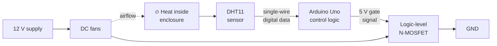
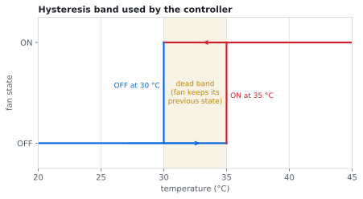
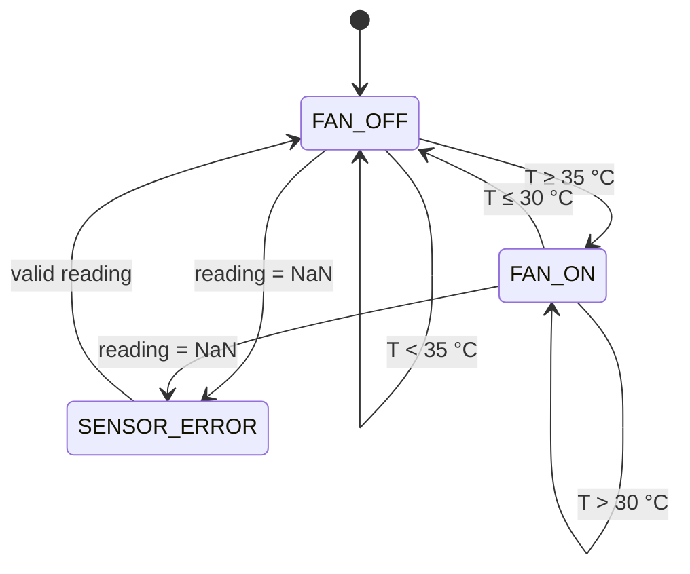
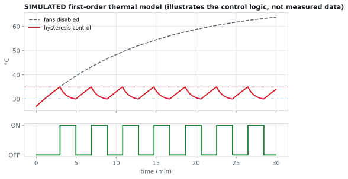

# 🌡️ GPU Thermal Management System

> A closed-loop cooling controller for a GPU enclosure: an Arduino reads temperature from a DHT11 and switches 12 V DC fans through a logic-level MOSFET, using hysteresis so the fans don't chatter.


---

## Contents
1. [Project Overview](#1-project-overview)
2. [Objective](#2-objective)
3. [Components](#3-components)
4. [Working Principle](#4-working-principle)
5. [Circuit Design](#5-circuit-design)
6. [Implementation](#6-implementation)
7. [Source Code](#7-source-code)
8. [Results](#8-results)
9. [Challenges](#9-challenges)
10. [Future Improvements](#10-future-improvements)

---

## 1. Project Overview

A GPU dumps a lot of heat into a small space. If that heat isn't moved out, the chip throttles or wears out faster. This project models that problem at prototype scale: an enclosure with a heat source, a temperature sensor, and fans that the controller turns on only when they're needed.

The interesting part isn't turning a fan on. It's separating the **5 V logic side** from the **12 V power side** cleanly, and making the controller behave sensibly when the temperature sits right at the threshold.



## 2. Objective

- Keep the enclosure temperature inside a defined band without running the fans all the time.
- Drive a 12 V load from a 5 V microcontroller pin **without** the pin ever carrying fan current.
- Avoid rapid ON/OFF switching (chatter) when temperature hovers around the setpoint.

## 3. Components

| Component | Role | Why this part |
|---|---|---|
| Arduino Uno | Controller | Plenty of I/O, 5 V logic matches the DHT11 and the MOSFET gate drive |
| DHT11 | Temperature sensor | Digital output, so no analog noise on long wires. Its 0–50 °C range covers this application. |
| Logic-level N-MOSFET (e.g. IRLZ44N) | Low-side fan switch | Fully on at V<sub>GS</sub> = 5 V. A standard MOSFET like the IRF540N is only partly on at 5 V and would run hot. |
| 12 V DC fans | Cooling actuator | Standard PC fans, quiet and cheap |
| 1N5819 Schottky diode | Flyback protection | Fans are motors, so they're inductive. Switching them off without a diode sends a voltage spike into the MOSFET. |
| 220 Ω resistor | Gate resistor | Limits the inrush current that charges the gate capacitance and damps ringing |
| 10 kΩ resistor | Gate pull-down | Holds the MOSFET off while the Arduino boots and its pins are still floating |
| 12 V supply | Fan power | Kept separate from the Arduino's 5 V rail |
| Enclosure | Simulated GPU housing | Cardboard in this prototype (see [Challenges](#9-challenges)) |

> **Reconstruction note:** Controller used in the reconstructed implementation: Arduino Uno. The MOSFET, diode and resistor values are the recommended parts for this design. Swap in the exact part numbers if your build differs.

A full bill of materials is in [`BOM.md`](BOM.md).

## 4. Working Principle

### 4.1 Signal path

1. The **DHT11** measures temperature and sends it as a 40-bit frame over one data wire.
2. The **Arduino** decodes the frame, giving a temperature in °C.
3. The **control logic** compares it with two thresholds (see 4.2) and decides the fan state.
4. **D9** drives the MOSFET gate HIGH (5 V) or LOW (0 V).
5. When the gate is high, the MOSFET connects the fans' negative lead to ground, current flows from the 12 V supply, and the fans spin.
6. Airflow carries heat out of the enclosure, the temperature falls, and the loop closes.

### 4.2 Why hysteresis and not one threshold

With a single threshold at 35 °C, a reading that flickers 34.9 → 35.0 → 34.9 flips the fans every sample. That's noisy, wears the fans, and creates switching transients for no reason.

So the controller uses **two** thresholds:

| Condition | Action |
|---|---|
| fans OFF and T ≥ 35 °C | turn fans ON |
| fans ON and T ≤ 30 °C | turn fans OFF |
| 30 °C < T < 35 °C | **keep the current state** |

<p align="center"></p>

Wider than the DHT11's ±2 °C accuracy, the 5 °C band means sensor noise alone can't toggle the fans.



### 4.3 Why low-side switching

Putting the MOSFET between the fans and **ground** means the source sits at 0 V, so the 5 V from the Arduino appears directly as V<sub>GS</sub>. On the high side (between +12 V and the fan), the source would float up near 12 V, and turning it on would need a gate driver or a P-channel part.

## 5. Circuit Design

### Connections

| From | To | Note |
|---|---|---|
| DHT11 VCC | Arduino 5V | |
| DHT11 DATA | Arduino D2 | 10 kΩ pull-up to 5 V (often already on the module) |
| DHT11 GND | GND | |
| Arduino D9 | 220 Ω → MOSFET Gate | |
| MOSFET Gate | 10 kΩ → GND | pull-down |
| MOSFET Source | GND | |
| MOSFET Drain | Fan (–) | |
| Fan (+) | +12 V | |
| 1N5819 | across the fan | cathode to +12 V, anode to drain |
| 12 V supply GND | Arduino GND | **common ground is required** |

### Schematic

```
                         +12V
                          │
                    ┌─────┴─────┐
                    │           │
                  ──┴──       ┌─┴─┐
          1N5819   ▲  (K up)  │FAN│
                  ──┬──       └─┬─┘
                    │           │
                    └─────┬─────┘
                          │ Drain
  Arduino D9 ──[220Ω]──┬──┤ IRLZ44N
                       │  │ Source
                    [10kΩ] │
                       │  │
  GND ─────────────────┴──┴──────── 12 V supply GND
```

Why the common ground matters: V<sub>GS</sub> is measured from gate to source. If the Arduino ground and the fan-supply ground aren't tied together, the "5 V" on the gate has no defined reference relative to the source, and the MOSFET may not turn on at all.

## 6. Implementation

1. Wire and test the DHT11 alone. Print readings to Serial and check them against a reference thermometer.
2. Build the power stage on its own. Drive D9 HIGH and LOW by hand and confirm the fans switch.
3. Measure the MOSFET case temperature with the fans running for a few minutes. A logic-level part should stay cool.
4. Combine both stages and load the hysteresis sketch.
5. Mount the sensor near the heat source and away from the direct fan airflow, so it measures the enclosure and not the breeze.
6. Test by heating the enclosure and watching the Serial log as it crosses both thresholds.

## 7. Source Code

📄 [`Code/gpu_thermal_management/gpu_thermal_management.ino`](Code/gpu_thermal_management/gpu_thermal_management.ino)

The core of the controller:

```cpp
if (!fanState && temperature >= FAN_ON_TEMP) {
  fanState = true;            // too hot → start cooling
} else if (fanState && temperature <= FAN_OFF_TEMP) {
  fanState = false;           // cooled enough → stop
}
// between the two thresholds: no change (this is the hysteresis)
digitalWrite(FAN_CONTROL_PIN, fanState ? HIGH : LOW);
```

Design decisions in the code:

| Decision | Reason |
|---|---|
| `delay(2000)` between reads | The DHT11 can't be sampled faster than about once per second. Reading faster returns stale or failed data. |
| `isnan()` check | A failed read returns NaN. Without the check, NaN comparisons are always false, so the fans would silently keep their last state. |
| `fanState` held in a variable | Hysteresis needs memory, because the decision depends on the current state as well as the temperature. |
| CSV output on Serial | Makes it easy to log a test run straight into [`Data/`](Data/) and plot it |

**Libraries:** *DHT sensor library* by Adafruit, plus its *Adafruit Unified Sensor* dependency.

## 8. Results

**Expected behavior**
- The fans stay off until the enclosure reaches the upper threshold, then run until it drops to the lower one.
- No chatter around the setpoint, because the 5 °C band absorbs sensor noise.
- The Arduino pin only drives the MOSFET gate, so it carries almost no current.

**What the control logic should produce.** This comes from a simple first-order thermal model, not measured data:

<p align="center"></p>

The dashed line shows what would happen with no cooling. The red line shows the controller holding the temperature in the 30–35 °C band by cycling the fans. The model is in [`Analysis/`](Analysis/).

**Measured performance.** To be filled in from a logged test run (template in [`Data/`](Data/)):

| Metric | Value |
|---|---|
| Initial temperature | — |
| Maximum temperature | — |
| Cooling activation point | — |
| Time to cool from 35 °C to 30 °C | — |
| Fan duty (fraction of time ON) | — |

## 9. Challenges

**The enclosure was cardboard.** This was the biggest compromise in the build. Cardboard is a poor material for a heat project: it insulates, so it holds heat inside, and it isn't something you want sitting near a hot component for long. During testing it was actually exposed to the heat. I chose it because of time and budget, and tried to manage the risk with the lowest-cost fixes I could make in the time I had.

What I took away from it:
- An enclosure is part of the thermal design. Its material changes how fast heat builds up and how hard the fans have to work.
- Next time: an aluminium or acrylic enclosure with a defined intake and exhaust path, so the air goes in one side, across the heat source, and out the other.

**Sensor placement.** If the sensor sits in the fan's airflow, it reads the moving air instead of the enclosure, and the controller turns the fans off too early.

**DHT11 limits.** ±2 °C accuracy and a slow sample rate are fine for a demo but not for real GPU monitoring. A real card reads its die temperature from an on-chip sensor.

## 10. Future Improvements

- [ ] **PWM fan speed control**: scale fan speed with temperature instead of switching it fully on or off (4-pin PWM fans, 25 kHz control).
- [ ] **Better sensor**: DS18B20 or an NTC thermistor for faster, more accurate readings.
- [ ] **OLED display** showing live temperature and fan state.
- [ ] **Data logging** to an SD card for long test runs.
- [ ] **Fans-off vs fans-on comparison** under the same heat load, to measure what the cooling actually achieves.
- [ ] **Custom PCB** combining the sensor input, MOSFET stage and fan headers on one board.

## References

See [`References/`](References/).
