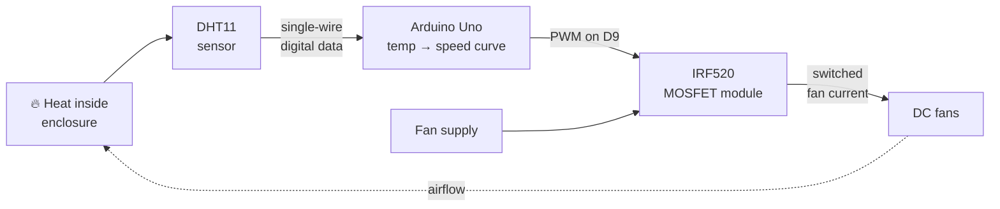
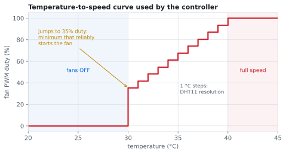
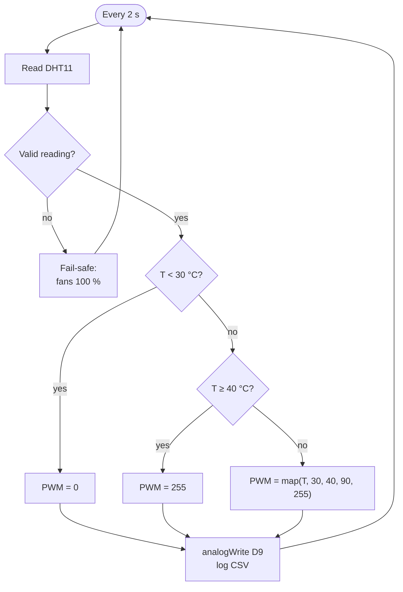

# 🌡️ GPU Thermal Management System

> An Arduino-based cooling system for a GPU enclosure: a DHT11 measures the temperature, and the Arduino adjusts fan speed with PWM through an IRF520 MOSFET module. The hotter it gets, the faster the fans spin.


---

## Contents
1. [Project Overview](#1-project-overview)
2. [Objective](#2-objective)
3. [Components](#3-components)
4. [Working Principle](#4-working-principle)
5. [Circuit Design](#5-circuit-design)
6. [Implementation](#6-implementation)
7. [Source Code](#7-source-code)
8. [Results](#8-results)
9. [Challenges](#9-challenges)
10. [Future Improvements](#10-future-improvements)

---

## 1. Project Overview

A graphics card turns a lot of power into heat in a small space. If that heat isn't removed, the chip throttles and its lifespan drops. Real GPUs handle this by scaling fan speed with temperature: quiet when idle, louder only when needed.

This project builds that behavior at prototype scale. A **DHT11** reads the enclosure temperature, an **Arduino** turns it into a fan-speed command, and an **IRF520 MOSFET module** switches the fan current using PWM.



## 2. Objective

- Cool the enclosure **in proportion** to how hot it is, instead of running the fans flat out all the time.
- Drive the fans from an external supply, so the Arduino pin only provides a control signal and never carries fan current.
- Understand PWM as a way to control the power going to a motor load.

## 3. Components

| Component | Role | Why this part |
|---|---|---|
| Arduino Uno | Controller | Hardware PWM on D9, 5 V logic that matches the sensor and the module |
| DHT11 | Temperature sensor | Digital output, so no analog noise on the wire. Its 0–50 °C range covers this application. |
| IRF520 MOSFET driver module | Fan power switch | A ready-made low-side switch: it has screw terminals for the load and supply, a SIG input pin, and an on-board indicator LED |
| DC cooling fans | Cooling actuator | Speed follows the average voltage, so PWM controls it directly |
| External DC supply | Fan power | Keeps fan current off the Arduino's regulator |
| Diode (e.g. 1N5819) | Flyback protection | Add one across the fans if your module doesn't have one on board (see [Challenges](#9-challenges)) |
| Enclosure | Simulated GPU housing | Cardboard in this prototype (see [Challenges](#9-challenges)) |

A full bill of materials is in [`BOM.md`](BOM.md).

## 4. Working Principle

### 4.1 Signal path

1. The **DHT11** measures temperature and sends it as a 40-bit digital frame on one wire.
2. The **Arduino** decodes the frame into a temperature in °C, every 2 seconds.
3. The **speed curve** (4.2) turns that temperature into a PWM value from 0 to 255.
4. `analogWrite()` outputs that PWM on **D9**, a 5 V square wave at about 490 Hz whose duty cycle sets the speed.
5. The PWM drives the **IRF520's gate** through the module's SIG pin. On each HIGH pulse the MOSFET conducts and connects the fans' negative terminal to ground.
6. The fans see the supply voltage switched on and off very quickly. Their inertia averages that out, so they spin at a speed set by the **duty cycle**:

$$V_{fan,avg} = D \times V_{supply}$$

### 4.2 Speed curve

| Temperature | Fan command | Why |
|---|---|---|
| below 30 °C | **0 %**: off | No cooling needed, so the system stays silent |
| 30 °C | **jump to ~35 %** | A DC fan won't start below a minimum duty. Starting at 0 % and ramping up would leave a range where the fan hums but doesn't turn. |
| 30–40 °C | **linear ramp** from 35 % to 100 % | More heat, more airflow |
| 40 °C and above | **100 %** | Full cooling capacity |

<p align="center"></p>

The DHT11 reports whole degrees, so the curve is really a **staircase** of 1 °C steps, not a smooth line.



### 4.3 Why low-side switching

The IRF520 sits between the fans and **ground**. That puts its source at 0 V, so the Arduino's PWM signal is applied directly as the gate-source voltage V<sub>GS</sub>. On the high side, the source would float up toward the supply voltage, and a 5 V signal couldn't turn the MOSFET on.

## 5. Circuit Design

### Connections

| From | To | Note |
|---|---|---|
| DHT11 VCC / GND | Arduino 5V / GND | |
| DHT11 DATA | Arduino D2 | 10 kΩ pull-up (usually already on the module) |
| IRF520 module SIG | Arduino D9 | PWM-capable pin |
| IRF520 module VCC / GND | Arduino 5V / GND | |
| IRF520 module VIN / GND | Fan supply + / − | |
| IRF520 module V+ / V− | Fan + / − | |
| Flyback diode | across the fans | cathode to fan +, anode to fan − |

### Inside the IRF520 module

```
   Fan supply +  ─────────────┬────────────┐
                              │            │
                            [FAN]       ──┴── diode
                              │          ▲  (cathode up)
                              │         ──┬──
                              ├───────────┘
                              │ Drain
   SIG (D9) ──[R]──┬──────────┤ IRF520
                   │          │ Source
                 [R pull-down]│
                   │          │
   GND ────────────┴──────────┴─────── Fan supply −
```

The module provides the gate resistor, the pull-down and the screw terminals. The fan supply's ground and the Arduino's ground are joined through the module's GND, which gives V<sub>GS</sub> a common reference.

## 6. Implementation

1. Wire the DHT11 alone and print readings to Serial to confirm they're sensible.
2. Connect the IRF520 module and the fans. Test with fixed values (`analogWrite(9, 0)`, `128`, `255`) to confirm the fans respond to duty cycle.
3. Find the **minimum starting duty**: raise the PWM value slowly from 0 and note where the fans actually start spinning. That's where `PWM_MIN` comes from.
4. Load the full sketch and mount the sensor near the heat source, out of the direct airflow.
5. Heat the enclosure and watch the Serial log as temperature and fan speed rise together.

## 7. Source Code

📄 [`Code/gpu_thermal_management/gpu_thermal_management.ino`](Code/gpu_thermal_management/gpu_thermal_management.ino)

The core of the controller:

```cpp
int temperatureToPwm(float temperature) {
  if (temperature < TEMP_MIN)  return 0;          // cool: fans off
  if (temperature >= TEMP_MAX) return PWM_MAX;    // hot: full speed
  return map((long)temperature, TEMP_MIN, TEMP_MAX, PWM_MIN, PWM_MAX);
}
```

Design decisions in the code:

| Decision | Reason |
|---|---|
| `PWM_MIN = 90` instead of starting from 0 | Below about 35 % duty the fans stall, so the ramp starts at a speed that actually spins them |
| Read every 2 s | The DHT11 can't be sampled faster than about once per second |
| Fail-safe on a failed read | If the sensor stops responding, the temperature is unknown. Running the fans at 100 % is the safe choice; switching them off isn't. |
| D9 for PWM | One of the Uno's hardware-PWM pins (Timer1) |
| CSV on Serial | A test run can be logged straight into [`Data/`](Data/) and plotted |

**Libraries:** *DHT sensor library* by Adafruit, plus its *Adafruit Unified Sensor* dependency.

> The temperature thresholds (30 °C / 40 °C) and `PWM_MIN` are illustrative values. Tune them for your fans and enclosure.

## 8. Results

**Expected behavior**
- The fans stay off while the enclosure is cool, start at around 30 °C, and speed up as it gets hotter.
- Speed changes in small steps instead of the fans slamming fully on or off, which makes the system quieter.

**What the control logic should produce.** This comes from a simple first-order thermal model, not measured data:

<p align="center"></p>

With no cooling (dashed line), the model heads toward about 69 °C. With PWM control, it settles a little above 30 °C with the fans at partial speed. That's the point of proportional control: just enough airflow to balance the heat. The model is explained in [`Analysis/`](Analysis/).

**Measured performance.** To be filled in from a logged test run (template in [`Data/`](Data/)):

| Metric | Value |
|---|---|
| Initial temperature | — |
| Maximum temperature | — |
| Fan start temperature | — |
| Steady-state temperature | — |
| Steady-state fan duty | — |

## 9. Challenges

**The enclosure was cardboard.** This was the biggest compromise in the build. Cardboard insulates, so it holds heat inside, and it isn't something you want sitting near a hot component for long. During testing it was actually exposed to the heat. I chose it because of time and budget, and tried to manage the risk with the lowest-cost fixes I could make in the time I had.

What I took away from it:
- The enclosure is part of the thermal design. Its material changes how fast heat builds up and how hard the fans have to work.
- Next time: an aluminium or acrylic enclosure with a defined intake and exhaust path.

**The IRF520 is not a logic-level MOSFET.** Its datasheet specifies R<sub>DS(on)</sub> at V<sub>GS</sub> = 10 V, and its gate threshold can be as high as 4 V. Driven from a 5 V Arduino pin, it's only **partly** turned on. That works for small fans, but the MOSFET drops more voltage and runs warmer than it would with a proper gate drive. A logic-level part such as the IRLZ44N is fully on at 5 V.

**Flyback protection.** Fans are motors, which makes them inductive. Every time PWM switches them off, they produce a voltage spike. Some IRF520 modules don't include a diode for this, so one should be added across the fan terminals.

**DHT11 limits.** With ±2 °C accuracy, 1 °C resolution and slow sampling, it's fine for a demo but coarse for control. That's why the fan speed moves in steps.

## 10. Future Improvements

- [ ] Replace the IRF520 with a **logic-level MOSFET** (IRLZ44N) and compare MOSFET temperature.
- [ ] Raise the PWM frequency to **25 kHz** (Timer1 registers) to remove audible whine.
- [ ] Use **4-pin PWM fans**, where the motor stays powered and only a control line carries PWM, and read their **tachometer** to measure actual RPM.
- [ ] Use a more precise sensor (**DS18B20** or an NTC thermistor) for smoother speed control.
- [ ] Add an **OLED** showing temperature, fan duty and RPM.
- [ ] Compare fans-off and fans-on under the same heat load, from logged data.
- [ ] Design a **custom PCB**: sensor input, logic-level MOSFET stage, flyback diode and fan headers on one board.

## References

See [`References/`](References/).
